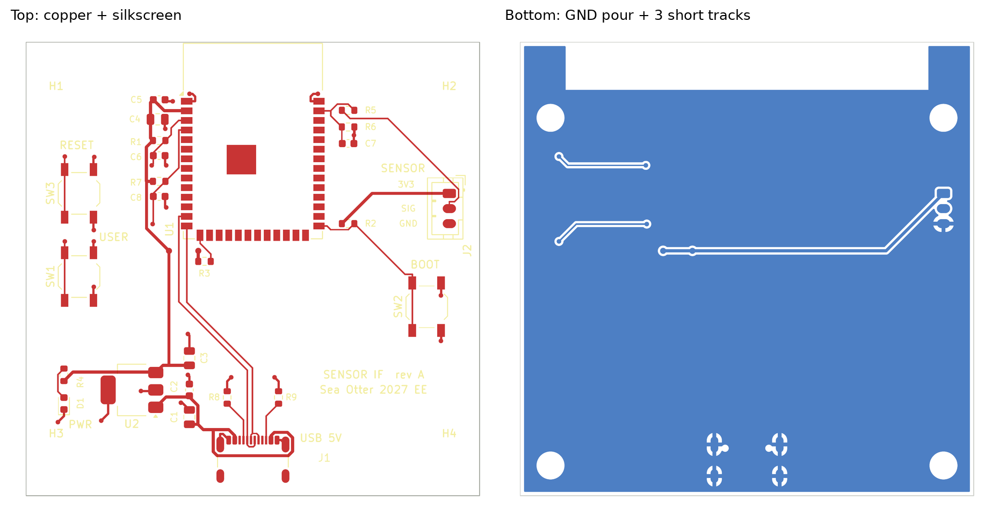

# Basic sensor interface PCB

EE subteam onboarding project. A 2-layer, 60 × 60 mm board that reads one 0 to 3.3 V analog sensor and one pushbutton with an ESP32-S3, powered and programmed over USB-C.

Calculations for the regulator, LED resistor, power budget, and trace widths are in `calculations.md`.

## Deliverables

| Item | File |
|---|---|
| Editable KiCad project | `kicad bike project.kicad_pro`, `.kicad_sch`, `.kicad_pcb`, `.kicad_dru` |
| Schematic PDF | `exports/schematic.pdf` |
| PCB layout PDF (one page per layer) | `exports/board_layout.pdf` |
| PCB layout screenshots | `board_preview.png`, `exports/board_top.png`, `exports/board_bottom.png` |
| Required calculations | `calculations.md` |
| Design decisions | this README |
| Checks | `ERC 3.rpt` (0 errors, 0 warnings), `DRC 4.rpt` (0 violations, 0 unconnected, schematic parity clean) |

## Block diagram

    USB-C (J1) --5 V--> AP7361C LDO (U2) --3.3 V--> ESP32-S3-WROOM-1 (U1)
        |                                               |
        +---- D+ / D- (native USB) ---------------------+
                                                         |
    Sensor connector (J2) --> divider + RC filter --> GPIO1 (ADC1_CH0)
    User button (SW1) --> pull-up + RC debounce --> GPIO4
    BOOT (SW2) --> GPIO0      RESET (SW3) --> EN

## Design decisions

**Microcontroller.** ESP32-S3-WROOM-1-N8 (8 MB flash, no PSRAM). It has native USB, so one USB-C port handles power and programming with no USB-to-serial chip. It also has an official KiCad symbol and footprint, which removes the risk of a hand-drawn footprint. The ESP32-C3-MINI-1 was the first choice, but KiCad's library has neither for it.

**Power.** 5 V comes from USB-C VBUS. CC1 and CC2 each get their own 5.1 kΩ pull-down (R8, R9), which tells a USB-C charger or port to turn on 5 V. The AP7361C LDO drops it to 3.3 V. An LDO fits because the load is under 0.5 A and the drop is only 1.7 V. See `calculations.md` for the heat check.

**Programming.** GPIO19 and GPIO20 are the chip's USB D− and D+. Both D+ pins on the USB-C connector are tied together, and both D− pins, so the cable works either way up. SW2 (BOOT) pulls GPIO0 low and SW3 (RESET) pulls EN low. Holding BOOT while tapping RESET forces download mode if USB auto-reset ever fails.

**Strapping pins.** GPIO0, GPIO3, GPIO45, and GPIO46 are read at power-up.
- GPIO0: internal pull-up plus R2 (10 kΩ). High = run the program, low = download mode.
- GPIO3: no internal pull, and the datasheet says it must not float. R3 (10 kΩ) pulls it up.
- GPIO45 and GPIO46: internal pull-downs are the correct levels, so both are left open.
None of these are used for the sensor or button.

**Analog input.** The ESP32-S3 ADC reads 0 to 3.1 V at its highest attenuation, so a 0 to 3.3 V sensor would clip at the top. A 10 kΩ / 30 kΩ divider scales 3.3 V to 2.475 V, leaving margin for resistor tolerance. A 100 nF cap at the ADC pin filters noise above about 212 Hz. The sensor uses GPIO1 (ADC1_CH0) because ADC2 is shared with Wi-Fi and its reads can fail while Wi-Fi runs.

**Digital input.** SW1 on GPIO4 is active low: 10 kΩ pull-up, button to ground, 100 nF for a 1 ms debounce. GPIO4 is not a strapping pin, so holding the button at power-up can't change the boot mode.

**Indicator.** D1 is a green power LED on the 3.3 V rail with a 680 Ω resistor (about 2 mA). It confirms the regulator works.

## Pin assignments (U1, ESP32-S3-WROOM-1)

| Module pin | Signal | Connection |
|---|---|---|
| 2 | 3V3 | LDO output, C4 + C5 local decoupling |
| 1, 40, 41 (pad) | GND | Ground plane |
| 3 | EN | R1 10 kΩ to 3V3, C6 1 uF to GND, SW3 to GND |
| 27 | IO0 | BOOT: R2 10 kΩ pull-up, SW2 to GND |
| 15 | IO3 | R3 10 kΩ pull-up (strapping) |
| 39 | IO1 | Sensor signal after divider (ADC1_CH0) |
| 4 | IO4 | User button SW1 |
| 13 | IO19 | USB D− |
| 14 | IO20 | USB D+ |
| All others | NC | No-connect flags in the schematic |

## Parts list

| Ref | Value / part | KiCad footprint | Purpose |
|---|---|---|---|
| U1 | ESP32-S3-WROOM-1-N8 | RF_Module:ESP32-S3-WROOM-1 | Microcontroller |
| U2 | AP7361C-33E-13 | Package_TO_SOT_SMD:SOT-223-3_TabPin2 | 5 V to 3.3 V LDO |
| J1 | USB-C, USB 2.0, 16-pin (GCT USB4105-GF-A) | Connector_USB:USB_C_Receptacle_GCT_USB4105-xx-A_16P_TopMnt_Horizontal | Power and programming |
| J2 | JST PH 3-pin (3V3, SIG, GND) | Connector_JST:JST_PH_B3B-PH-K_1x03_P2.00mm_Vertical | Sensor connector |
| SW1, SW2, SW3 | Tactile switch | Button_Switch_SMD:SW_SPST_TL3342 | USER, BOOT, RESET |
| D1 | LTST-C191KGKT green LED | LED_SMD:LED_0603_1608Metric | Power indicator |
| R1, R2, R3, R7 | 10 kΩ | Resistor_SMD:R_0603_1608Metric | EN, strapping, and button pull-ups |
| R4 | 680 Ω | Resistor_SMD:R_0603_1608Metric | LED current limit |
| R5 | 10 kΩ 1 % | Resistor_SMD:R_0603_1608Metric | Divider top |
| R6 | 30 kΩ 1 % | Resistor_SMD:R_0603_1608Metric | Divider bottom |
| R8, R9 | 5.1 kΩ | Resistor_SMD:R_0603_1608Metric | USB-C CC pull-downs |
| C1 | 4.7 uF 10 V X5R | Capacitor_SMD:C_0805_2012Metric | LDO input |
| C2 | 100 nF | Capacitor_SMD:C_0603_1608Metric | LDO input bypass |
| C3 | 10 uF 10 V X5R | Capacitor_SMD:C_0805_2012Metric | LDO output |
| C4 | 22 uF 10 V X5R | Capacitor_SMD:C_0805_2012Metric | Module 3V3 bulk |
| C5 | 100 nF | Capacitor_SMD:C_0603_1608Metric | Module 3V3 bypass |
| C6 | 1 uF | Capacitor_SMD:C_0603_1608Metric | EN delay |
| C7 | 100 nF | Capacitor_SMD:C_0603_1608Metric | ADC filter |
| C8 | 100 nF | Capacitor_SMD:C_0603_1608Metric | Button debounce |
| H1 to H4 | M3 mounting hole | MountingHole:MountingHole_3.2mm_M3 | Mounting |

## Board layout

60 × 60 mm, 2 layers, fully routed. KiCad 10 DRC: 0 violations, 0 unconnected items, 0 schematic-parity issues.

- **Module (U1).** Centered on the top edge, antenna 0.3 mm inside the edge so its silkscreen stays on the board. KiCad's footprint carries an antenna keep-out on both layers. It blocks tracks, vias, pours, and parts in a 6 mm strip along the top edge.
- **Mounting holes.** The bottom pair sits 4 mm from each edge. The top pair sits 10 mm down, because the antenna keep-out covers the normal corner spot.
- **USB-C (J1).** Bottom edge, positioned on the footprint's "PCB Edge" mark. CC pull-downs R8 and R9 sit either side.
- **Power.** The AP7361C (U2) sits lower left with its input facing J1. C1 and C2 are at the input and C3 at the output. The power LED (D1, R4) is on the left edge.
- **Module support.** C5 and C4 sit next to module pins 1 and 2 (GND, 3V3). The EN parts (R1, C6) and button parts (R7, C8) form a column on the left. RESET (SW3) and USER (SW1) are on the left edge.
- **Sensor.** Divider R5, R6, and C7 sit right next to GPIO1 (pin 39). J2 is on the right edge, silkscreen-labeled 3V3 / SIG / GND. BOOT (SW2) and its pull-up R2 are on the right side near GPIO0 (pin 27).
- **Ground.** The bottom layer has a GND pour, tied to the USB-C shield, J2 pin 3, and the module's ground-pad vias.
- **Silkscreen.** Every label sits clear of copper, other silkscreen, and the board edge. Pin labels on J2 read 3V3 / SIG / GND, and the connectors and buttons are labeled USB 5V, SENSOR, RESET, USER, and BOOT.

### Net classes

| Class | Nets | Track | Via |
|---|---|---|---|
| Power | VBUS, +3V3 | 0.4 mm | 0.8 mm / 0.4 mm drill |
| Ground | GND | 0.3 mm | 0.6 mm / 0.3 mm drill |
| Default | everything else | 0.2 mm | 0.6 mm / 0.3 mm drill |

The first plan was 0.5 mm for power. That width could not reach the USB-C VBUS pins or squeeze past the regulator and the passives beside the module, so the router left those connections open. 0.4 mm still carries 1.2 A by IPC-2221, 3.4 times the 357 mA worst case (see `calculations.md`).

### DRC exceptions (`kicad bike project.kicad_dru`)

Both come from the official KiCad land patterns, not from the layout:

1. U1's exposed ground pad has 0.2 mm thermal vias. The board minimum is 0.3 mm, so the rule allows 0.2 mm for pads inside U1 only.
2. J1's alignment holes sit 0.19 mm from its GND pads. The board minimum is 0.25 mm, so the rule allows 0.15 mm inside J1 only.

### Routing

Routed with Freerouting 2.1 and checked with KiCad's DRC after every attempt. Ten variants were tried with different widths, via costs, and strategies. The final board is the cleanest: 27 vias, about 345 mm of top-layer track, and nothing left unrouted.

Before the autorouter ran, three things were drawn by hand and locked:

1. **USB D+ and D−.** Both pairs of connector pads are tied on the top layer, D+ just above the pad row and D− just below it, with no vias. From there the two lines run up together and turn 45° as a parallel pair into module pins 13 and 14.
2. **One 3.3 V crossing under the USB pair.** 3.3 V has to reach R2, R3, and J2 on the right of the USB pair. It crosses on the bottom layer with a 3.9 mm hop just below the module, at right angles to the USB lines. That keeps the ground pour under the USB pair almost unbroken.
3. **Ground as a plane.** GND was given to the router as the bottom-layer plane, so every top-side ground pad drops straight down through its own via.

What is on the bottom layer besides the ground pour:

- the 3.3 V hop under the USB pair, plus a 3.3 V run under the module's bottom edge out to R2 and J2
- two short hops on the left edge for EN and BUTTON out to the RESET and USER switches

These come from the placement. The 3.3 V pads and the EN and BUTTON pads alternate down the column beside the module, so something has to cross. None of these tracks runs under the USB lines.

## How the scripts work

The schematic and the first board layout were generated by Python scripts rather than drawn by hand, then finished and checked in KiCad 10. Each script is short and does one job. They run on KiCad's Python module (`pcbnew`, KiCad 7 or later) and need Java 21 for Freerouting.

| Step | Script | What it does |
|---|---|---|
| 1. Read the library | `tools/sexp.py`, `tools/extract.py` | KiCad files are plain-text s-expressions (nested parentheses). These read the official symbol library and pull out each part's pins and their positions. |
| 2. Draw the schematic | `tools/gen_sch.py` | Places every symbol, draws a short wire from each pin to a net label or power symbol, adds no-connect flags, and writes `kicad bike project.kicad_sch`. |
| 3. Check the connections | `tools/check_net.py` | Has KiCad export the netlist, then compares every net against the intended connection table. It passed on all 14 nets before the file was used. |
| 4. Place the board | `tools/gen_pcb.py` | Uses KiCad's Python API to load each footprint, place it, link it to its schematic symbol, assign nets, draw the 60 × 60 mm outline, and add the bottom ground pour. |
| 5. Check the board | `tools/check_pcb.py` | Refills the ground pour and runs KiCad's DRC from Python. |
| 6. Route | `tools/routing/` | `preroute.py` draws and locks the USB pair and the 3.3 V hop. The board is exported to Specctra DSN, `mkdsn.py` makes width variants, and Freerouting routes each one. `ses_apply.py` loads a result back, and `evaluate.py` removes leftover stubs and duplicates, runs DRC, and scores it. `render.sh` makes the preview images. |
| 7. KiCad 10 cleanup | `tools/hide_desc.py`, `tools/verify_v10.py` | Hides the Description field that KiCad 10 added to every symbol, and confirms no pins moved after the library update. |

The Freerouting command used for each variant:

    java -jar freerouting-2.1.0.jar --gui.enabled=false -de board.dsn -do board.ses -mp 40

The silkscreen labels were then moved clear of copper with a short clearance search (`tools/routing/silk_labels.py`), and the final DRC (`DRC 4.rpt`) and ERC (`ERC 3.rpt`) were run in KiCad 10 itself.

### Learning resources

| Topic | Used in | Video |
|---|---|---|
| KiCad's Python API (`pcbnew`) | steps 4 to 6 | [The Python Whisperer Guide, KiCon 2019](https://www.youtube.com/watch?v=_zVJ96SdYrs) (Contextual Electronics) |
| Running DRC from Python | steps 5 and 6 | [Automated PCB Design Rule Validation Using KiCad Python API](https://www.youtube.com/watch?v=i7LbWIcxQyk) (Learning By Tutorials) |
| KiCad command line (`kicad-cli`) | step 3 | [KiCad 8: More powerful command line interface](https://www.youtube.com/watch?v=j4sTVdC6o-U) (Tech Explorations) |
| Installing Freerouting | step 6 | [KiCad 8.0 Autorouter Installation in Under 4 Minutes](https://www.youtube.com/watch?v=zKeVWIWrCuI) (Stuart Patterson) |
| DSN export and SES import | step 6 | [How to Autoroute in KiCad 7.0 with FreeRouting](https://www.youtube.com/watch?v=duw2oUJPp9w) (Pcb Cupid) |
| Cleaning up after the autorouter | step 6 | [How to install and use KiCad FreeRouting, incl. manual cleanup and DRC](https://www.youtube.com/watch?v=ESrHILARL7Y) (eRCaGuy) |
| Custom DRC rules (`.kicad_dru`) | DRC exceptions | [Level up Your Custom Rules, KiCon Asia 2023](https://www.youtube.com/watch?v=_kk5-yVSDWk) (KiCad) |

Reference docs: [KiCad schematic file format](https://dev-docs.kicad.org/en/file-formats/sexpr-schematic/) (step 2) and [Freerouting command-line arguments](https://github.com/freerouting/freerouting/blob/master/docs/command_line_arguments.md) (step 6).

KiCad 10 renamed the USB-C shield pin from S1 to SH, so the J1 footprint's shield pads use SH to match.

## Open items

- Add the sensor's own current to the power budget once a sensor is chosen.
- Optional: USB ESD protection (e.g. USBLC6-2SC6) and a 500 mA PTC fuse on VBUS.
- The D− pad tie on J1 runs 0.3 mm past the pad row, just under the edge of the connector body. Check the GCT USB4105 drawing for any copper keep-out there before ordering boards.
